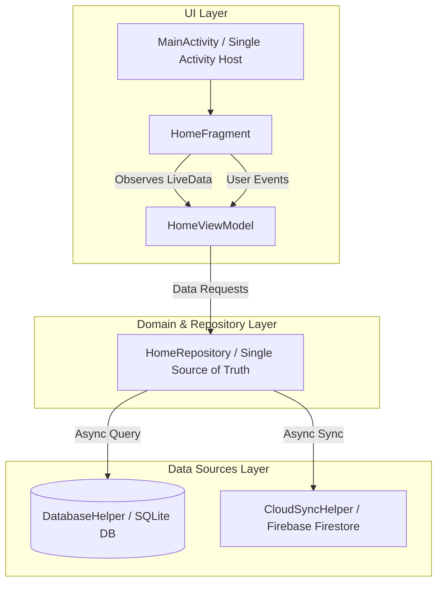

# FixitBhai Architectural Specifications

## Architectural Overview
FixitBhai follows **MVVM (Model-View-ViewModel)** with a clean **Repository pattern**.

## Layer Responsibilities and Dependency Rules

1. **UI Layer (`ui/`)**:
   - `Fragment` / `Activity` rendering UI states (`LOADING`, `SUCCESS`, `ERROR`, `EMPTY`).
   - Strictly contains **no business logic**, no direct network calls, and no raw cursor handling.
   - Observes immutable `LiveData` exposed by `ViewModel`.

2. **ViewModel Layer (`ui/*/ViewModel`)**:
   - Manages UI state and survives configuration changes (rotation) and process death via `SavedStateHandle`.
   - Never holds a `Context`, `Activity`, or `View` reference to prevent memory leaks.
   - Emits single-time events using `Event<T>` wrapper.

3. **Repository Layer (`data/repository`)**:
   - Acts as the single source of truth for the application.
   - Coordinates local database queries and cloud network sync.

4. **Data Sources Layer (`data/local`, `data/remote`)**:
   - Handles raw database operations (`SQLiteOpenHelper`) and API calls (`Firebase Firestore` / `Retrofit`).
